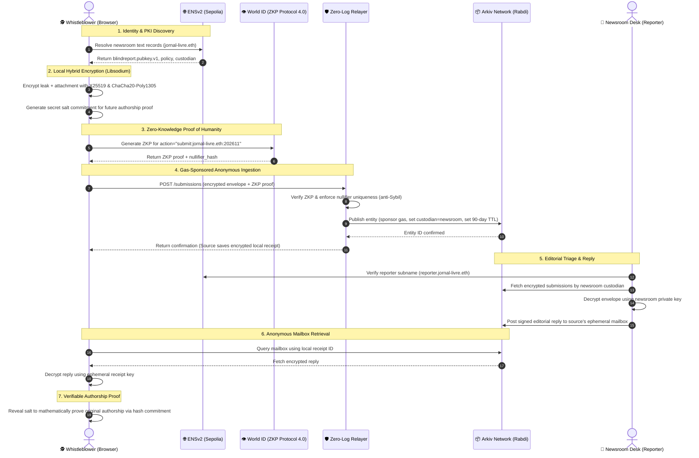

# Blind Report

[](https://ethglobal.com/events/mumbai)
[](https://ethglobal.com/showcase/blind-report-8ubn9)
[](tests/)
[](https://sepolia.etherscan.io/)
[](https://rabdi.explorer.arkiv.network)
[](https://worldcoin.org/)
[](LICENSE)

> **Zero-Knowledge, Sybil-Resistant Whistleblowing & Leak Architecture for Investigative Journalism.**  
> Built for **ETHGlobal Mumbai** by combining **ENSv2**, **Arkiv Network**, and **World ID Protocol 4.0** with client-side **Libsodium** authenticated encryption.

---

## ⚡ Executive Summary

Investigative whistleblowers risk imprisonment, state prosecution, and physical retaliation to expose corruption, human rights violations, and financial fraud. Yet existing submission channels face a fatal trilemma:

1. **Centralized Trust & PKI Fragility:** Sources rely on TLS certificates issued by centralized Certificate Authorities (CAs) and DNS records vulnerable to BGP hijacking, state-level spoofing, or domain seizure.
2. **The Sybil vs. Deanonymization Paradox:** If a leak portal is completely open, it is overwhelmed by automated botnets and spam. If it requires accounts, phone numbers, or signatures from KYC/personal wallets, the source's anonymity is compromised.
3. **Forensic Sprawl & Indefinite Storage:** Traditional databases and permanent IPFS pins create perpetual forensic footprints susceptible to retroactive correlation, subpoenas, and privacy violations (such as GDPR right-to-be-forgotten non-compliance).

**Blind Report** solves all three problems by fusing three cutting-edge decentralized protocols:

- **Decentralized PKI & Delegated Subnames via ENSv2:** Newsrooms publish encryption keys and editorial policies directly into `.eth` text records. Reporters receive cryptographically verifiable subnames (`reporter.newsroom.eth`) through the ENS NameWrapper.
- **Zero-Knowledge Anti-Sybil Defense via World ID:** Proves humanity via ZKP (World ID Protocol 4.0) with dynamic monthly action strings (`submit:newsroom:epoch`). Nullifiers strictly enforce **one leak per human per newsroom per month** without ever exposing civil identity or linking separate submissions.
- **Decentralized Ephemeral Storage via Arkiv Network:** Envelopes are stored with programmed block-based expiration (e.g. 90-day retention) and custody transfer to the newsroom. Third-party relayers sponsor gas fees so sources never expose an on-chain funding trail.
- **Two-Way Anonymous Communication:** An encrypted mailbox enables journalists to reply to the source. The source fetches replies from Arkiv using a local ephemeral secret receipt—no accounts, no IPs, no sessions.
- **Verifiable Authorship Proof:** Whistleblowers retain a cryptographic salt commitment, allowing them to mathematically prove original authorship in court or to other media outlets months later without prior deanonymization.

---

## 🏅 Award — ETHGlobal Mumbai 2026

> **World — “Best Use of IDKit”**, awarded to **Blind Report** at [ETHGlobal Mumbai](https://ethglobal.com/events/mumbai).  
> [Official showcase](https://ethglobal.com/showcase/blind-report-8ubn9) · [Live demo](https://blind-report.vercel.app) · [Award record](ETHGLOBAL.md)

World ID 4.0 personhood proofs are bound to `submit:<newsroom>:<epoch>`, so the relayer enforces **one submission per human per newsroom per month** through a nullifier hash — spam-resistant without ever identifying the source.

---

## 🏆 ETHGlobal Mumbai — Partner Prizes Showcase

Blind Report specifically targets and integrates the following **3 Partner Prize tracks**:

| Partner | Prize Track | Role in Blind Report | Implementation Package |
| :--- | :--- | :--- | :--- |
| **ENS** | **Best Use of ENS / ENSv2 Identity** | Decentralized PKI for public encryption keys, editorial policies, and delegated subnames (`reporter.newsroom.eth`) | [`packages/ens-client`](packages/ens-client) |
| **Arkiv Network** | **Decentralized Storage & Data Lifecycle** | Immutable encrypted envelope storage, programmed block-based retention, gas sponsorship, custody delegation, and two-way anonymous mailbox replies | [`packages/arkiv-store`](packages/arkiv-store) |
| **World ID** | **Best Use of World ID / Proof of Humanity** | Zero-knowledge anti-Sybil protection with monthly epoch nullifiers bound to newsrooms (`submit:newsroom:epoch`) | [`packages/worldid-gate`](packages/worldid-gate) |

### 1. Ethereum Name Service (ENSv2)
- **Decentralized Public Key Directory:** Whistleblowers enter `jornal-livre.eth`. The client resolves the newsroom's Libsodium encryption key from the on-chain text record `blindreport.pubkey.v1` and its editorial submission rules from `blindreport.policy` via Sepolia Universal Resolver.
- **Delegated Reporter Subnames:** The newsroom mints official ERC-1155 subnames (`reporter.jornal-livre.eth`) via NameWrapper. Editorial responses are signed by the reporter, allowing the source to mathematically verify institutional authority directly from the blockchain.
- **Partner Feedback:** Leveraging structured text records and subname delegation turns ENS from a simple wallet address pointer into a sovereign, censorship-resistant cryptographic directory indispensable for human rights and journalism.

### 2. Arkiv Network (Rabdi Testnet)
- **Programmed Block-Based Retention:** Unlike permanent storage networks where leaked files linger forever, Arkiv allows setting precise block-expiration lifetimes (e.g., 90-day active investigation window), ensuring true right-to-be-forgotten compliance.
- **Third-Party Gas Sponsorship & Custody Transfer:** The source sends the encrypted envelope to a zero-log Relayer. The Relayer pays the gas on Arkiv and sets the entity `custodian` to the newsroom's Ethereum address. The source remains completely decoupled from on-chain transactions.
- **Anonymous Ephemeral Mailbox:** Newsrooms reply by sealing messages to the source's ephemeral key and storing them under `type=reply&mailbox=<id>`. Whistleblowers query Arkiv directly with their local receipt.
- **Partner Feedback:** Native block expiration and custodian transfer are game-changing features for sensitive data handling and legal compliance.

### 3. World ID (Worldcoin Protocol 4.0)
- **Action-Bound Dynamic ZKP:** Zero-Knowledge proofs are generated with the action dynamically bound to the target newsroom and the current month:
  $$\text{action} = \text{"submit:"} + \text{newsroomName} + \text{":"} + \text{epoch}$$
  *(e.g., `submit:jornal-livre.eth:202611`)*
- **Mathematical Sybil Resistance:** Each person produces a deterministic 248-bit Nullifier Hash for that specific action. If a spammer or compromised device attempts to submit a second report to the same newsroom in the same month, the Relayer rejects it with `409 Conflict (SYBIL_ATTACK_DETECTED)`.
- **Zero Cross-Context Linkability:** Next month (`epoch`), a completely new nullifier is generated, preventing any correlation between reports submitted by the same human across different epochs or newsrooms.
- **Partner Feedback:** World ID is the missing cryptographic primitive for anonymous reporting: it solves denial-of-service spam while preserving 100% mathematical anonymity.

---

## 📐 System Architecture & Protocol Flow



---

## 🌐 Testnet Deployments & Verified On-Chain Artifacts

### Ethereum Sepolia Testnet (Chain ID: `11155111`)

| Contract | Address | Purpose |
| :--- | :--- | :--- |
| **ENS Registry** | [`0x00000000000C2E074eC69A0dFb2997BA6C7d2e1e`](https://sepolia.etherscan.io/address/0x00000000000C2E074eC69A0dFb2997BA6C7d2e1e) | Root ENS Registry & Resolver Dispatcher |
| **Universal Resolver** | [`0x8FADE66B79cC9f707aB26799354482EB93a5B7dD`](https://sepolia.etherscan.io/address/0x8FADE66B79cC9f707aB26799354482EB93a5B7dD) | Multicall Name & Cryptographic Text Record Resolution |
| **Public Resolver** | [`0x1da022710dF50023FB37746df8d30ac7ea971169`](https://sepolia.etherscan.io/address/0x1da022710dF50023FB37746df8d30ac7ea971169) | Newsroom Profile & Public Encryption Key Store |
| **NameWrapper** | [`0x0635513f179D50A207757E05759Cb1f12E45371b`](https://sepolia.etherscan.io/address/0x0635513f179D50A207757E05759Cb1f12E45371b) | ERC-1155 Subname Minting & Journalist Delegated Authority |

**Showcase Test Accounts (Sepolia):**
- **Newsroom Owner (Deployer):** [`0x8cf0ff092E8B41EA2C957989a713F75a9ECDC4fc`](https://sepolia.etherscan.io/address/0x8cf0ff092E8B41EA2C957989a713F75a9ECDC4fc)
- **Authorized Reporter:** [`0x3C8E9FE1Cd5dE98D9245c028d00a7ADC1880Dd3d`](https://sepolia.etherscan.io/address/0x3C8E9FE1Cd5dE98D9245c028d00a7ADC1880Dd3d)
- **Sponsoring Relayer:** [`0x77DD7d6DaA32DF7F34FEbd0eaeBD6B1a1c9a1D8F`](https://sepolia.etherscan.io/address/0x77DD7d6DaA32DF7F34FEbd0eaeBD6B1a1c9a1D8F)

### Arkiv Network (Rabdi Testnet)
- **RPC Endpoint:** `https://rpc.rabdi.db-chain.testnet.arkiv.network`
- **Block Explorer:** [Arkiv Rabdi Explorer](https://rabdi.explorer.arkiv.network)
- **SDK Integration:** `@arkiv-network/sdk` (v1.0.0)

### World ID (Protocol 4.0 Staging)
- **App ID:** `app_4042c24254a33097907e995869d6e132`
- **RP ID:** `rp_4847560e061aacf6`
- **Action Binding:** Dynamic string template `submit:<newsroom>:<epoch>`

---

## 📁 Monorepo Structure

```
blind-report/
├── packages/
│   ├── core/            # Domain types, epoch rules, validation, and payload encoding
│   ├── crypto/          # Libsodium X25519 envelopes, mailbox IDs, and salt commitments
│   ├── network-policy/  # Strict CSP, RPC allowlists, and zero-telemetry enforcement
│   ├── ens-client/      # ENSv2 Universal Resolver, multicall text records, and subnames
│   ├── arkiv-store/     # Arkiv SDK backend, block expiration, custody, and query indexing
│   ├── worldid-gate/    # World ID Protocol 4.0 ZKP verification and nullifier gate
│   ├── source-client/   # Whistleblower client SDK (headless submission pipeline)
│   └── newsroom-client/ # Editorial desk SDK (headless decryption, triage, and reply)
├── apps/
│   └── relayer/         # Ingestion microservice with zero IP logging and gas sponsorship
├── WEBSITE/             # Unified Web Portal (Next.js 16 + React 19 + Tailwind CSS)
│   ├── app/             # Whistleblower submit, receipt manager, and editorial dashboard
│   ├── components/      # Glassmorphic UI components, partner inspector, and audio cues
│   └── test/            # Frontend unit and component test suite
├── guardrails/          # Static AST scanner ensuring clean web3 crypto (no Tor/mixnet deps)
├── scripts/             # Interactive demo flow, Sepolia live broadcast, and key generation
└── tests/
    ├── e2e/             # End-to-end partner prize and full-stack integration tests
    └── fixtures/        # Mock nodes and simulation test fixtures
```

---

## 🔒 Security & Privacy Guarantees

Blind Report was designed against a formal five-tier adversarial threat model ([see THREAT_MODEL.md](THREAT_MODEL.md)):

1. **Client-Side Envelope Encryption:** Plaintext never leaves the browser in unencrypted form. Payloads and attachments are encrypted using **Libsodium X25519** and **ChaCha20-Poly1305**.
2. **Zero Third-Party Telemetry (RNF-05):** Build-time static guardrails (`npm run guardrails`) guarantee zero trackers, zero external fonts or CDN dependencies, and strict Content Security Policies.
3. **Pure Web3 Anonymity (Zero Tor/Mixnet Lock-in):** Anonymity is achieved cryptographically via zero-knowledge nullifiers, zero-log gas relayers, and on-chain PKI, eliminating brittle dependencies on Tor or SOCKS proxies.
4. **Tamper-Proof Authorship Commitment:** Sources obtain a cryptographic commitment `SHA-256(plaintext || salt)`. Whistleblowers can reveal the salt later to prove they were the original author, while maintaining complete anonymity until they choose to do so.

---

## 🚀 Quickstart & How to Run

### Prerequisites
- **Node.js:** `>= 22.0.0`
- **npm:** `>= 10.0.0`

### 1. Installation

```bash
# Clone the repository
git clone https://github.com/rayangustavo/blind-report.git
cd blind-report

# Install root monorepo dependencies
npm install

# Install website frontend dependencies
npm run website:install
```

### 2. Run the Interactive Terminal Demo (1 Minute)

Experience the complete end-to-end cryptographic lifecycle in your terminal with colored callouts highlighting **ENS**, **Arkiv**, and **World ID**:

```bash
npm run demo
```

*This script executes the entire 8-step protocol: newsroom setup, client encryption, World ID ZKP proof, relayer ingestion, Arkiv custody transfer, editorial decryption, anonymous reply, and mathematical authorship proof.*

### 3. Launch the Unified Web Portal

Start the local development environment (Next.js 16 frontend + Relayer backend):

```bash
npm run dev:all
# Alternatively: npm run dev
```

- Open **`http://localhost:3000`** in your browser.
- **Whistleblower View:** Try the `⚡ 1-Click Load: "Procurement Corruption" Leak` button, resolve `jornal-livre.eth` on Sepolia, run the ZKP Proof of Humanity simulator, and submit an encrypted leak.
- **Editorial Desk View:** Decrypt the submission, inspect the Arkiv block retention, and dispatch a sealed reply.
- **Verification Tab:** Test the zero-knowledge mathematical authorship proof with the receipt salt.

### 4. Run Partner Prize Automated Test Suite

Run the specialized automated test suite covering all Partner Prize evaluation criteria:

```bash
npm run test:partners
```

### 5. Run the Complete Monorepo Test Suite

Run all **634 unit and integration tests** across all 8 packages:

```bash
npm test
```

### 6. Verify Security & Network Guardrails

Run the static AST analyzer to verify zero telemetry, zero IP leakage, and strict security boundaries:

```bash
npm run guardrails
npm run test:guardrails
```

### 7. Run Live On-Chain Sepolia Flow

Broadcast real transactions to Ethereum Sepolia and Arkiv Rabdi:

```bash
npm run test:sepolia:flow
```

*Executes on-chain resolver deployment, `.eth` name registration, text record multicalls, subname delegation, and live Arkiv entity storage.*

---

## 📚 Submission Documentation & Links

For judges and technical reviewers, comprehensive documentation is provided in the repository:

- 🏅 **[ETHGLOBAL.md](ETHGLOBAL.md):** Official submission record, showcase link, and the World **Best Use of IDKit** award.
- 📑 **[PARTNER_PRIZES.md](PARTNER_PRIZES.md):** In-depth technical architecture for ENS, Arkiv, and World ID, along with direct partner feedback.
- 🌐 **[DEPLOYMENTS.md](DEPLOYMENTS.md):** On-chain contract addresses, network configurations, and Sepolia verification instructions.
- 🛡️ **[THREAT_MODEL.md](THREAT_MODEL.md):** Formal security model, 5-tier adversary analysis, and cryptographic proofs.
- 🎬 **[DEMO_SCRIPT.md](DEMO_SCRIPT.md):** 2 to 4 minute demo video script, cue sheet, and judging storyboard.
- 🤖 **[SPEC_ATTRIBUTION.md](SPEC_ATTRIBUTION.md):** AI tools disclosure and spec-driven engineering methodology record.

---

## 📄 License

This project is open-source software licensed under the **[MIT License](LICENSE)**.
